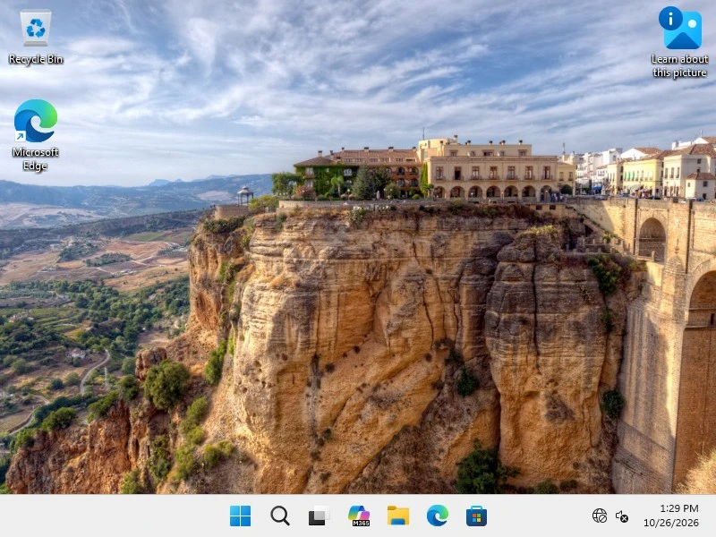

# GMBox

A lightweight VMware Fusion clone for Apple silicon, written in **C99** (no Python).
`vmfc` CLI + AppKit GUI; Linux guests on `Virtualization.framework`; **Windows 11 ARM64**
guests on a native `Hypervisor.framework` VMM (`tools/hvf_win.c`), with no QEMU at runtime.



*Windows 11 Pro ARM64 desktop, booted by the native Hypervisor.framework VMM (no QEMU).*

## Status

- **Windows 11 Pro ARM64 boots to the desktop** in the native HVF VMM: EDK2/UEFI → Windows Boot
  Manager → kernel → sign-in → desktop (verified from the framebuffer).
- **Linux (VZ)**: EFI, NVMe, ISO as USB, NAT networking, keyboard/mouse, audio, virtio graphics.
- **VMware import**: split-sparse VMDK → raw; BitLocker detection.

The native VMM emulates: GICv3 (HVF), timers, PL011, PL031, fw_cfg (ACPI tables generated in C),
CFI flash for UEFI variables, PCIe ECAM, an **NVMe** controller, a **USB EHCI** controller with HID
keyboard and mouse, and a **ramfb** framebuffer. The PMU is emulated by the framework (`PMUVer=1`).

## Build and run

```sh
make            # CLI + GUI
make acpi       # regenerate the ACPI tables (needs iasl)
make hvf-win    # native Windows VMM (build/hvf_win)
```

Example (use **a copy** of the disk: Windows writes to it):

```sh
cp -c "vms/Windows 11 Pro.vmfc/disk.raw" /tmp/d.raw
cp -c "vms/Windows 11 Pro.vmfc/vars.fd"  /tmp/v.fd
mkfifo /tmp/in.fifo
GMBOX_INPUT=/tmp/in.fifo GMBOX_AUTOENTER=1 GMBOX_REBOOT_ON_OFF=1 \
GMBOX_FB_DUMP=/tmp/s.bmp GMBOX_FB_INTERVAL=10 \
GMBOX_DISK=/tmp/d.raw GMBOX_VARS=/tmp/v.fd GMBOX_WATCHDOG_SEC=900 build/hvf_win
```

Keyboard/mouse input: write commands to the FIFO (`key space`, `type text`, `key enter`,
`move dx dy`, `click l`, …). Read the screen from the BMP (`sips -s format png s.bmp --out s.png`).

Useful variables: `GMBOX_FW`, `GMBOX_VARS`, `GMBOX_DISK`, `GMBOX_NVME_LOG`, `GMBOX_USBLOG`,
`GMBOX_KDBRK` (prints the drivers loaded by the Windows kernel), `GMBOX_NO_USB`.

## VM CLI

```sh
vmfc create --wizard                 # guided VM creation
vmfc clone "Windows 11 Pro" "Windows Lab"
vmfc disk "Windows 11 Pro"
vmfc compact "Windows 11 Pro"          # VM stopped
vmfc iso "Windows 11 Pro" /path/to/install.iso
vmfc iso "Windows 11 Pro" --none
vmfc check "Windows 11 Pro" --fix
vmfc list --filter windows --tag work
vmfc tag "Windows 11 Pro" lavoro
vmfc status "Windows 11 Pro"
vmfc pause "Windows 11 Pro"
vmfc resume "Windows 11 Pro"
vmfc reboot "Windows 11 Pro"
vmfc stop "Windows 11 Pro" --force
vmfc autostart "Windows 11 Pro"        # start at login
vmfc autostart "Windows 11 Pro" --status
vmfc autostart "Windows 11 Pro" --disable
```

`vmfc autostart` writes a per-VM LaunchAgent under `~/Library/LaunchAgents` and loads it in the
current Aqua session; `--dry-run` prints the plist without changing the system. The agent gives the
VM 30 seconds to shut down cleanly at logout.

The VM library scans subfolders, shows status, disk/RAM, last start and tags. Tags are stored in
`config.vmx` (`vmfc.tags`). VZ guests accept pause/resume through `SIGUSR1`/`SIGUSR2`, reboot through
a graceful stop/start, and record status in `vmfc.state`. Windows uses the native
`build/hvf_win` runner, not `vmfc start`.

## Current limitations

- The native VMM is a **prototype**: firmware, VARS and disk paths are still partly hard-coded.
- **A single vCPU** only (boot measured on the dev Mac: ~15 s to the lock screen, ~31 s to the desktop; one run, warm APFS clone, not yet a cold-boot benchmark).
- Display is `ramfb` 800x600 only: no 3D acceleration, no audio, no clipboard or shared folders.
- No networking in the native VMM; no vTPM, Secure Boot or USB passthrough.
- No snapshots and no VM encryption.
- Minimal ACPI (no IORT/DBG2), PCIe without MSI-X, relative mouse only (no absolute pointer).
- If the disk carries failed boots, Windows shows the *Recovery* screen: `GMBOX_AUTOENTER=1` is needed.
- Windows guests on VZ are unsupported (iBoot/NVRAM bug); installing from ISO in the native VMM is untested.

## Layout

- `src/` — `vmfc` CLI and GUI app (VZ, VMDK import).
- `tools/hvf_win.c` and `tools/*.inc` — native VMM, USB, tracers, ACPI (`acpi_build.c`, `dsdt.asl`).
- `tools/firmware/` — EDK2 firmware (build recipe in `tools/firmware/README.md`).

Project rule: C99 / shell only, no Python.

## License

Apache-2.0; see [LICENSE](LICENSE) and [NOTICE](NOTICE). The EDK2 firmware images in
`tools/firmware/` are built from TianoCore EDK2 and keep their own (BSD-2-Clause-Patent) licence.
